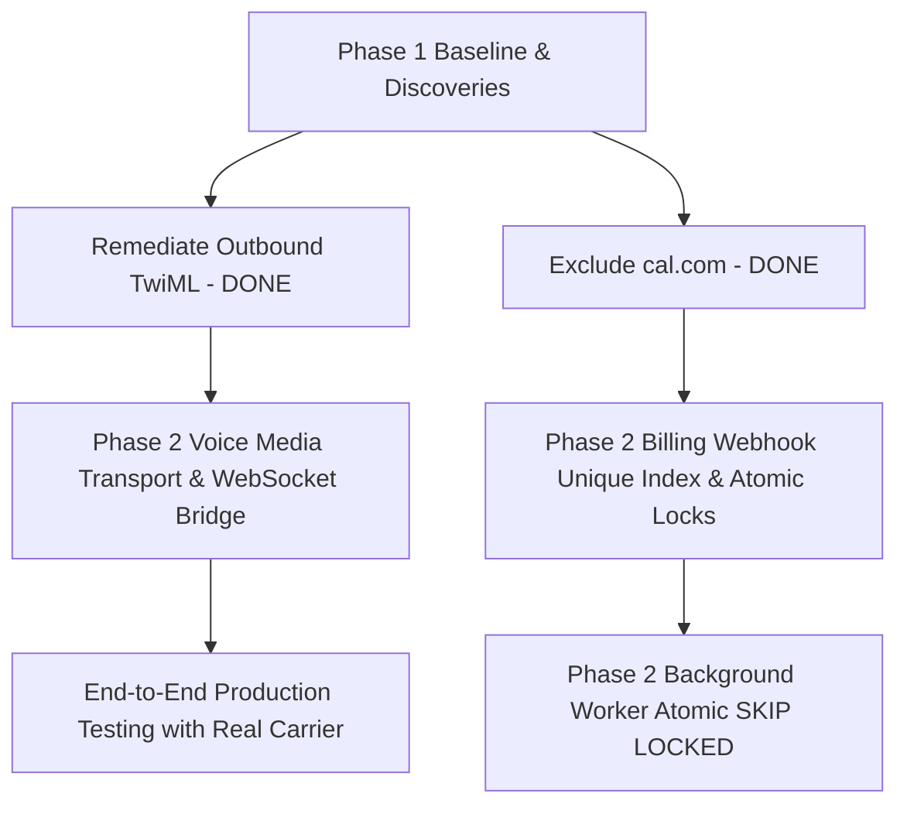

# Operator Phase 1: Architecture Remediation Plan

This remediation plan outlines prioritized, evidence-backed engineering actions to bring the Operator AI Receptionist SaaS from its current state to a production-reliable release.

---

## Remediation Roadmap



---

## 1. Action Items

### REM-001: Telephony Outbound Carrier TwiML Dispatch
- **ID:** `REM-001`
- **Severity:** High (P1)
- **Status:** **RESOLVED & VERIFIED IN PHASE 1**
- **Files Affected:**
  - `src/app/api/voice/twiml/route.ts` (created)
  - `src/proxy.ts` (updated to bypass edge session auth for `/api/voice`)
- **Root Cause:**
  `initiateOutboundCallAction` dispatched calls to Twilio using `${appBaseUrl}/api/voice/twiml`. Because this route handler was missing and `/api/voice` was blocked by edge proxy, Twilio received a 404/redirect and aborted outbound calls.
- **Verification:**
  `next build` compiled `/api/voice/twiml` into the production route bundle with exit code 0.
- **Rollback Strategy:**
  Remove `src/app/api/voice/twiml/route.ts` and revert `src/proxy.ts`. Low risk.

---

### REM-002: Inbound Twilio Media Stream WebSocket Gateway
- **ID:** `REM-002`
- **Severity:** Critical (P0)
- **Status:** **PLANNED FOR PHASE 2**
- **Files Affected:**
  - `src/app/api/webhooks/voice/inbound/route.ts`
  - `src/app/api/webhooks/voice/stream/route.ts`
- **Root Cause:**
  Next.js App Router route handlers run over standard HTTP and cannot upgrade to WebSocket protocol (`HTTP 101 Switching Protocols`). Twilio Media Streams require a persistent bidirectional WebSocket connection.
- **Recommended Remediation:**
  Implement a dual-track strategy:
  1. *Immediate Managed Path:* Provide integration with telephony voice platform (such as Vapi / Retell) where audio streaming and carrier telephony are handled natively by dedicated telephony clusters, while Operator provides the backend RAG context, booking actions, and business rules via Webhook / Tool calling.
  2. *Self-Hosted WebSocket Gateway:* Stand up a lightweight Node.js/ws service (or AWS API Gateway WebSocket bridge) deployed on ECS/Fly.io/Render dedicated to holding persistent Twilio Media Stream connections and piping audio packets to Deepgram and Kokoro TTS.
- **Dependencies:** Requires choice of telephony transport architecture (Vapi API key or dedicated WebSocket server deployment).
- **Migration Risk:** Low risk to existing database or web application; operates as a standalone telephony transport gateway.

---

### REM-003: Database-Level Webhook Idempotency & Unique Event Index
- **ID:** `REM-003`
- **Severity:** High (P1)
- **Status:** **RECOMMENDED FOR PHASE 2**
- **Files Affected:**
  - `src/server/db/schema.ts` (`billingEvents` table)
  - `src/server/services/billing/webhook-processor.ts`
- **Root Cause:**
  The current idempotency check loads all events of a given type from the database into memory and checks array containment in Node.js. Lacks a unique database index on `providerEventId`.
- **Recommended Remediation:**
  1. Add column `providerEventId text not null` with a unique index to `billing_events` table in `schema.ts`.
  2. In `webhook-processor.ts`, perform an atomic insert:
     ```ts
     try {
       await db.insert(billingEvents).values({
         eventType: `${provider}.${eventType}`,
         providerEventId,
         payload: { ... }
       });
     } catch (err: any) {
       if (err.code === "23505") { // Unique violation
         return { processed: false, duplicate: true, message: "Duplicate webhook event ignored." };
       }
       throw err;
     }
     ```
- **Dependencies:** Drizzle schema migration for `billing_events`.
- **Migration Risk:** Low risk; existing records can be backfilled with `providerEventId` from payload JSON before applying unique index.

---

### REM-004: Atomic Background Job Worker with `FOR UPDATE SKIP LOCKED`
- **ID:** `REM-004`
- **Severity:** Medium (P2)
- **Status:** **RECOMMENDED FOR PHASE 2**
- **Files Affected:**
  - `src/server/services/jobs/worker.ts`
- **Root Cause:**
  A two-step `findMany` followed by sequential `update` creates a race condition when multiple cron triggers fire simultaneously.
- **Recommended Remediation:**
  Update `processPendingJobs` to execute a single atomic SQL query:
  ```ts
  const lockedJobs = await db.execute(sql`
    UPDATE background_jobs
    SET status = 'processing', locked_at = NOW()
    WHERE id IN (
      SELECT id FROM background_jobs
      WHERE status = 'pending' AND run_at <= NOW()
      ORDER BY run_at ASC
      FOR UPDATE SKIP LOCKED
      LIMIT ${limit}
    )
    RETURNING *;
  `);
  ```
- **Dependencies:** None; uses standard PostgreSQL features supported by Neon.
- **Migration Risk:** Zero schema risk; purely an execution query refinement.

---

## 2. Regression Testing Strategy
When applying Phase 2 remediations:
1. **Telephony Inbound:** Test using Twilio Test Credentials or Twilio CLI webhook simulation with signature headers.
2. **Billing Idempotency:** Execute concurrent simulated Stripe webhook deliveries (`stripe-mock` or parallel HTTP requests) with identical `event.id` to verify exactly one subscription/invoice record is created.
3. **Background Worker:** Spawn parallel worker threads executing `processPendingJobs` simultaneously on a batch of 20 jobs to verify 0 duplicate executions occur.
