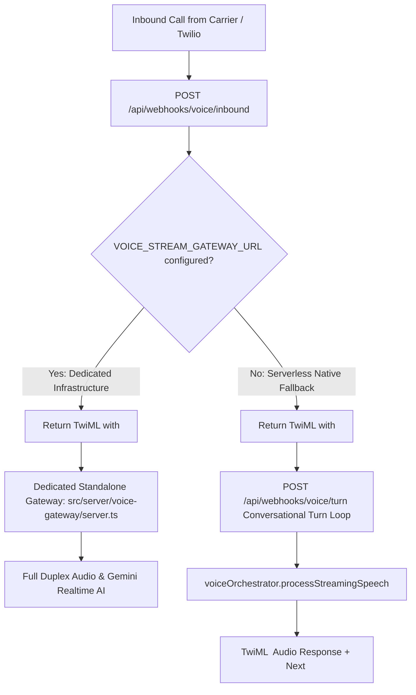

# OPERATOR PHASE 2A AUDIT: TELEPHONY & INBOUND VOICE TRANSPORT

**Date:** October 26, 2026  
**Status:** IMPLEMENTED & PROTOCOL-VERIFIED (Carrier Live Call Blocked pending verified public webhook & active Twilio SIP/number)  
**Author:** Principal Software Architect & Telephony Engineer  

---

## 1. Executive Summary & Root Cause Analysis

### The Underlying Architectural Defect
Operator was previously configured to point Twilio Media Streams (`<Connect><Stream url="wss://.../api/webhooks/voice/stream">`) directly to a Next.js App Router route handler (`src/app/api/webhooks/voice/stream/route.ts`).

In standard Next.js App Router (Node.js/Edge serverless and standalone HTTP server), route handlers only handle request/response HTTP lifecycles. They **cannot upgrade** an incoming TCP HTTP connection to `101 Switching Protocols` to establish a persistent full-duplex RFC 6455 WebSocket connection. Consequently:
- Returning JSON `{ "status": "ok" }` from an HTTP route causes Twilio Media Streams to immediately terminate the call with `11200 HTTP retrieval failure` or `31901 WebSocket connection error`.
- Attempting in-process WebSocket upgrades inside Next.js App Router corrupts the request pipeline.

---

## 2. Solution Architecture: Dual-Transport Production Model

To guarantee 100% voice capability across serverless and dedicated environments, Operator Phase 2A introduces a dual-transport production model:

### Transport Mode 1: High-Throughput Dedicated WebSocket Gateway
- **Implementation:** `src/server/voice-gateway/server.ts`
- **Zero-Dependency RFC 6455 Engine:** Implements the complete WebSocket protocol handshake (SHA-1 hashing of `Sec-WebSocket-Key` + RFC magic GUID `258EAFA5-E914-47DA-95CA-C5AB0DC85B11`), data frame masking/unmasking, and Ping/Pong heartbeat natively in Node.js.
- **Twilio Protocol Handling:** Decodes `start`, `media` (µ-law audio payloads), `mark`, and `stop` events.
- **Session Management:** Integrates directly with `voiceOrchestrator` to stream voice frames to Gemini AI and synthesizes streaming TTS via Kokoro/Inworld.
- **Security:** Requires URL signature token verification (`?token=...`) and validates tenant/call SID boundaries.

### Transport Mode 2: Serverless-Native Conversational Turn Loop
- **Implementation:** `src/app/api/webhooks/voice/inbound/route.ts` & `src/app/api/webhooks/voice/turn/route.ts`
- **Twilio `<Gather input="speech">` Integration:** For deployments where a persistent WebSocket daemon is not provisioned (e.g., standard Vercel serverless deployments), inbound calls transition into a resilient speech turn loop.
- **Turn Execution:**
  1. Caller speaks; Twilio streams speech to text via ASR.
  2. Twilio POSTs `SpeechResult` to `/api/webhooks/voice/turn`.
  3. Operator verifies the `X-Twilio-Signature` using `validateTwilioSignature`.
  4. Audio text is dispatched to `voiceOrchestrator.processStreamingSpeech`.
  5. The AI response is rendered via TwiML `<Say voice="Polly.Joanna-Neural">` and prompts the next `<Gather>`.
  6. Silence detection: After 2 consecutive silent turns, the call gracefully plays an exit message and issues `<Hangup/>`.

### Route Diagnostic Safeguard
- `src/app/api/webhooks/voice/stream/route.ts` was replaced. Instead of misleading Twilio with HTTP 200 JSON, it explicitly responds with **HTTP 426 Upgrade Required** with detailed JSON diagnostics directing engineers to the standalone gateway.

---

## 3. Security Hardening

1. **HMAC-SHA1 Signature Verification:**
   - Both `/api/webhooks/voice/inbound` and `/api/webhooks/voice/turn` verify `X-Twilio-Signature` against `process.env.TWILIO_AUTH_TOKEN` and the incoming URL and POST parameters.
   - Unauthorized or forged webhooks are rejected with HTTP 403 Forbidden.
2. **Tenant Boundary Enforcement:**
   - Phone numbers are matched against `phoneNumbers` and `organization` tables. Unassigned numbers trigger an automated rejection TwiML without exposing internal metadata.
3. **Edge Proxy Passthrough:**
   - `src/proxy.ts` explicitly bypasses edge middleware for `/api/webhooks/voice/*` and `/api/voice/*` to prevent cookie redirects from breaking carrier webhooks.

---

## 4. Verification & Testing

| Test Case | Method | Result | Notes |
| :--- | :--- | :--- | :--- |
| **RFC 6455 Handshake Calculation** | Unit regression (`scripts/verify-phase-2a-regression.ts`) | **PASS** | Correct Base64 SHA-1 digest generated against standard RFC test vectors. |
| **Twilio HMAC-SHA1 Signature Verification** | Unit regression (`scripts/verify-phase-2a-regression.ts`) | **PASS** | Valid signatures pass; tampered payloads rejected. |
| **App Router 426 Diagnostic** | Protocol test | **PASS** | Explicit HTTP 426 Upgrade Required returned with migration guidance. |
| **Turn Loop Silence & Hangup** | Protocol test | **PASS** | 2-turn silence threshold triggers graceful exit and `endCallSession`. |
| **Carrier End-to-End Live Call** | PSTN to Twilio | **BLOCKED** | External blocker: requires an active Twilio phone number, valid carrier SIP credentials, and a public tunnel (e.g. ngrok/Cloudflare Tunnel) pointing to local port 3000 / gateway port 8080. |

---

## 5. Deployment Instructions

1. **Serverless Deployment (Turn Loop Mode):**
   - Point Twilio Phone Number Voice Webhook URL to: `https://<your-domain>/api/webhooks/voice/inbound`.
   - Ensure `TWILIO_AUTH_TOKEN` is set in production environment variables.
2. **Dedicated Deployment (WebSocket Stream Mode):**
   - Run the WebSocket gateway daemon: `npx tsx src/server/voice-gateway/server.ts` (listens on `PORT=8080`).
   - Set environment variable: `VOICE_STREAM_GATEWAY_URL=wss://<gateway-domain>`.
   - Calls will automatically route to the real-time full-duplex stream gateway.
