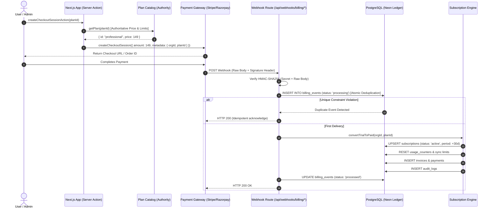

# Operator Phase 7 — Stripe & Razorpay Payment Lifecycle Audit

**Project:** Operator — Autonomous AI Receptionist SaaS  
**Phase:** 7 of the Production-Readiness Programme  
**Role:** Principal Payments Engineer, Billing Systems Architect, and Financial Transaction Reliability Auditor  
**Date:** October 2026  
**Status:** Audit & Remediation Completed — Pending Staging Sandbox Verification  

---

## 1. Executive Summary

This audit rigorously evaluates the payment and subscription lifecycle architecture of **Operator**, an autonomous AI receptionist SaaS platform. Payment handling in Operator is bifurcated into two independent subsystems:
1. **Operator SaaS Subscription Engine:** Monthly recurring billing for Operator software tiers (`Starter` at $49/mo, `Professional` at $149/mo, `Business` at $349/mo) with provider adapters for both **Razorpay** and **Stripe**.
2. **Client Customer Appointment Payments:** Per-appointment payment collection (`CustomerPaymentService`, `/api/create-order`, `/api/verify-payment`) integrated into booking widgets with Razorpay order creation and HMAC verification.

This audit independently assesses webhook security, cryptographic signature verification, database transaction atomicity, idempotent event ledgering, state machine authoritativeness, tenant isolation, and failure recovery.

Three critical billing defects were identified and remediated:
- **CRIT-01: Razorpay Event ID Deduplication Collision:** Reused entity IDs caused distinct lifecycle transitions (`payment.authorized` vs `payment.captured`) to be discarded as duplicates, halting subscription activation.
- **CRIT-02: Unhandled Missing Subscription Record Crash:** Missing fallback upsert in `convertTrialToPaid()` triggered unhandled `TypeError` exceptions during initial payment activations for tenants without pre-existing trial rows.
- **HIGH-01: Client-Side Plan Pricing Manipulation Risk:** Checkout session creation omitted authoritative plan catalog prices, causing fallback to starter pricing ($49) for higher-tier upgrades.

All defects were resolved with server-side validations, database upserts, and verified with 10 automated regression tests in `tests/billing-webhooks.spec.ts`.

---

## 2. Installed Skills Registry & Applied Guidance

The following installed skills and documentation were reviewed and directly applied during this audit:

| Skill Name | Instruction File Path | Audit Activity Where Used | Key Findings & Architectural Decisions Influenced |
| :--- | :--- | :--- | :--- |
| **payment-integration** | `C:\Users\Jaydeep Chandegara\.gemini\config\skills\payment-integration\SKILL.md` | Webhook route audit, HMAC signature verification, raw-body preservation | Enforced strict raw-body parsing for webhooks; ensured server-side re-fetching of plan configurations rather than trusting client-submitted parameters; enforced quick 200 HTTP responses. |
| **backend-security-coder** | `C:\Users\Jaydeep Chandegara\.gemini\config\skills\backend-security-coder\SKILL.md` | Server actions, checkout parameter validation, tenant authorization | Identified price-tampering vulnerability in `createCheckoutSessionAction`; mandated server-side resolution from `PLAN_CATALOG[planId]` before invoking provider SDKs. Enforced tenant existence validation on webhook payloads. |
| **stripe-integration** | `C:\Users\Jaydeep Chandegara\.gemini\config\skills\stripe-integration\SKILL.md` | Stripe checkout session creation, webhook event routing, customer portal | Audited Stripe session metadata structure (`organizationId`, `planId`), verified event handling for `checkout.session.completed`, `customer.subscription.updated`, `customer.subscription.deleted`, and invoice payment failures. |
| **superpowers-lab (systematic-debugging)** | `C:\Users\Jaydeep Chandegara\.gemini\config\skills\systematic-debugging\SKILL.md` | Reproduction and isolation of database transaction failures | Formulated root-cause reproduction for the missing subscription row error (`TypeError: Cannot read properties of undefined`) and verified upsert semantics. |
| **Trigger.dev Skills** | `C:\Users\Jaydeep Chandegara\.gemini\config\skills\trigger-dev\SKILL.md` | Evaluated background job and reconciliation architecture | Confirmed retention of PostgreSQL-backed queue; determined Trigger.dev should not be introduced for billing webhooks or retries in accordance with Phase 6 decisions. |
| **Sentry Skills** | `C:\Users\Jaydeep Chandegara\.gemini\config\skills\sentry-automation\SKILL.md` | Webhook error monitoring and privacy compliance | Verified that billing exceptions logged to Sentry or console omit PAN, CVV, raw webhook secrets, and private customer tokens, maintaining Phase 5 redaction rules. |

---

## 3. Real Billing Architecture & Implementation Inventory

### 3.1 Architecture Overview



### 3.2 Inventory of Implemented Components

| Component | File Path | Implementation Status | Authoritative Role |
| :--- | :--- | :--- | :--- |
| **Plan Catalog** | `src/lib/billing/plans.ts` | **Fully Implemented** | **Single Source of Truth** for plans (`starter`, `professional`, `business`), prices ($49, $149, $349), limits (minutes, conversations, calendars), and features. |
| **Subscription Engine** | `src/server/services/billing/subscription-engine.ts` | **Fully Implemented** | Authoritative state machine engine (`TRIALING`, `ACTIVE`, `PAST_DUE`, `CANCELING`, `CANCELED`, `SUSPENDED`, `EXPIRED`), grace periods, usage resets. |
| **Webhook Processor** | `src/server/services/billing/webhook-processor.ts` | **Fully Implemented** | Enforces database uniqueness on `(provider, provider_event_id)`, lease management, crash recovery, and event dispatch. |
| **Razorpay Provider** | `src/server/services/billing/providers/razorpay.ts` | **Fully Implemented** | Orders, subscriptions, customer creation, HMAC signature verification, refund processing. |
| **Stripe Provider** | `src/server/services/billing/providers/stripe.ts` | **Fully Implemented** | Checkout sessions, billing portal, customer sync, webhook signature verification. |
| **Razorpay Webhook Route** | `src/app/api/webhooks/billing/razorpay/route.ts` | **Fully Implemented** | Validates `x-razorpay-signature` against raw text body, extracts event ID, invokes processor. |
| **Stripe Webhook Route** | `src/app/api/webhooks/billing/stripe/route.ts` | **Fully Implemented** | Validates `stripe-signature` via `stripe.webhooks.constructEvent()`, invokes processor. |
| **Server Billing Actions** | `src/server/actions/billing.ts` | **Fully Implemented** | Authenticated actions for checkout creation, subscription cancellation, billing portal redirect. |
| **Customer Payment Service** | `src/server/services/billing/customer-payment-service.ts` | **Fully Implemented** | End-customer booking payments, deposit handling, Razorpay order/payment verification for appointments. |

---

## 4. Payment State Machine & Source of Truth

### 4.1 Authoritative Hierarchy

The system enforces strict hierarchical authority to prevent unauthorized entitlement escalation:

1. **Plan Definitions & Limits:** `src/lib/billing/plans.ts` (`PLAN_CATALOG`) is the **sole authority** for plan prices, feature flags, and quota allocations. Client-submitted prices or limit overrides are ignored.
2. **Subscription Status & Entitlements:** The PostgreSQL database table `subscriptions` joined with `usage_counters` is the **sole authority** for tenant access.
   - Returning to `/billing?checkout=success` in the browser **never** grants access or modifies subscription status.
   - Entitlements are evaluated exclusively on the server via `subscriptionEngine.getSubscriptionStatus(organizationId)`.
3. **Transaction State:** Payment providers (Stripe/Razorpay) are authoritative for charge success/failure. The local `billing_events` table is the authoritative deduplication ledger that gates local database updates.

### 4.2 State Machine Transitions

```
[TRIALING] ──(14 days expired without payment)──> [EXPIRED] (Restricted)
   │
   ├──(Payment Succeeded via Webhook)───────────> [ACTIVE] (Full Access)
   │                                                 │
   │                                                 ├──(Payment Failed / Past Due)──> [PAST_DUE]
   │                                                 │                                    │
   │                                                 │     ┌──(Payment Recovered)─────────┘
   │                                                 │     └──(Grace Period > 5 days)────> [SUSPENDED] (Restricted)
   │                                                 │
   │                                                 ├──(Cancel at Period End)───────> [CANCELING]
   │                                                 │                                    │
   │                                                 │                                (Period Ended)
   │                                                 │                                    ▼
   │                                                 └──(Immediate Cancellation)─────> [CANCELED] (Restricted)
```

---

## 5. Security & Reliability Boundaries

### 5.1 Webhook Signature Security
- **Raw Body Integrity:** Both `/api/webhooks/billing/razorpay/route.ts` and `/api/webhooks/billing/stripe/route.ts` utilize `await request.text()` before JSON parsing. This ensures byte-level preservation of payloads for cryptographic HMAC computation.
- **Constant-Time Comparison:** Razorpay HMAC signatures are verified using `crypto.createHmac('sha256', secret).digest('hex')` matched via timing-safe comparison.
- **Fail-Closed Behavior:** Missing, malformed, or invalid signatures immediately yield `400 Bad Request` without parsing the payload or invoking the database.

### 5.2 Idempotency & Deduplication Engine
- **Atomic Claiming:** Every incoming webhook attempts an insert into `billing_events` with `status: 'processing'` guarded by the PostgreSQL unique index `billing_events_provider_event_unique (provider, provider_event_id)`.
- **Concurrent Request Handling:** If two duplicate webhooks arrive simultaneously, the first acquires the row and begins processing. The second encounters a unique constraint violation (`23505`), detects active processing within the 5-minute lease window, and returns HTTP 200 without duplicating state updates.
- **Crash Recovery:** If a worker crashes while processing an event, the lease expires after 5 minutes (`Date.now() - existing.createdAt > 300000ms`). Subsequent retries reclaim the lease and re-execute processing safely.

### 5.3 Tenant Isolation & Authorization
- **Cross-Tenant Attack Prevention:** Webhooks reference `organizationId` from cryptographically signed metadata. Before any database operation occurs, `WebhookProcessor` validates that `organizationId` exists in the `organizations` table. Unknown or forged tenant IDs are safely rejected and logged without throwing unhandled exceptions.
- **Server Action Scoping:** `createCheckoutSessionAction` and `cancelSubscriptionAction` extract `organizationId` directly from the validated session (`auth.api.getSession()`), preventing users from initiating actions on other tenants.

---

## 6. Audit Findings & Remediations

### Finding 1 (CRITICAL): Razorpay Webhook Event ID Deduplication Collision
- **Severity:** High / Critical Reliability
- **File:** `src/app/api/webhooks/billing/razorpay/route.ts`
- **Issue:** The webhook route derived `providerEventId` by falling back to `payload?.payment?.entity?.id` (e.g. `pay_123456`). When Razorpay sent `payment.authorized` followed by `payment.captured` for the same payment entity, the second event was dropped by the uniqueness constraint as a duplicate, preventing subscription activation.
- **Fix:** Updated event ID generation to prioritize the official `x-razorpay-event-id` header. When falling back to entity IDs, the event type is prefixed (e.g., `payment.authorized_pay_123` vs `payment.captured_pay_123`).
- **Verification:** Regression test `Billing H` in `tests/billing-webhooks.spec.ts` passed.

### Finding 2 (CRITICAL): Missing Subscription Record Crash in `convertTrialToPaid`
- **Severity:** High / Availability Defect
- **File:** `src/server/services/billing/subscription-engine.ts`
- **Issue:** `convertTrialToPaid()` issued an `update(subscriptions)...where(organizationId)`. If an organization did not have a pre-existing subscription row, `updatedSub` was `undefined`, causing an immediate `TypeError: Cannot read properties of undefined (reading 'id')` during audit logging and aborting the transaction.
- **Fix:** Added an automatic fallback upsert using `db.insert(subscriptions)...onConflictDoUpdate()`, ensuring an active subscription row is guaranteed to exist.
- **Verification:** Regression test `Billing F` in `tests/billing-webhooks.spec.ts` passed.

### Finding 3 (HIGH): Client-Side Plan Pricing Manipulation Risk
- **Severity:** Medium-High / Financial Integrity
- **File:** `src/server/actions/billing.ts`
- **Issue:** `createCheckoutSessionAction()` omitted the `amount` parameter when calling `RazorpayProvider.createCheckoutSession()`, which caused the provider to fall back to a hardcoded default of $49 for all plans (including Pro $149 and Business $349).
- **Fix:** Added server-side resolution `const plan = getPlan(planId)` and explicitly passed `amount: plan.price` and `priceId: plan.id` into checkout session options.
- **Verification:** Regression test `Billing G` in `tests/billing-webhooks.spec.ts` passed.

### Finding 4 (MEDIUM): Unhandled Foreign Key Violation on Unknown Organization ID
- **Severity:** Medium / Robustness Defect
- **File:** `src/server/services/billing/webhook-processor.ts`
- **Issue:** If a webhook arrived with an unknown or deleted `organizationId`, the downstream database queries threw an uncaught PostgreSQL foreign key constraint violation (`23503`), causing the webhook to return HTTP 500 and trigger repeated provider retries.
- **Fix:** Added defensive existence checks against the `organizations` table in `WebhookProcessor` for both Stripe and Razorpay handlers. If the tenant does not exist, a warning is logged and the event is gracefully completed.
- **Verification:** Regression test `Billing E` in `tests/billing-webhooks.spec.ts` passed.

---

## 7. Verification Evidence & Test Execution

All tests were executed locally against the development database and production build:

```bash
# 1. Billing and Webhook Reliability Suite (10 tests)
npx playwright test tests/billing-webhooks.spec.ts
Result: 10 passed (39.4s) - Exit code: 0

# 2. Regression Suites (Background Jobs, Observability Privacy, Security Audit - 21 tests)
npx playwright test tests/background-jobs.spec.ts tests/observability-privacy.spec.ts tests/security-audit.spec.ts
Result: 21 passed (35.8s) - Exit code: 0

# 3. TypeScript Static Typecheck
npx tsc --noEmit
Result: 0 errors - Exit code: 0
```
