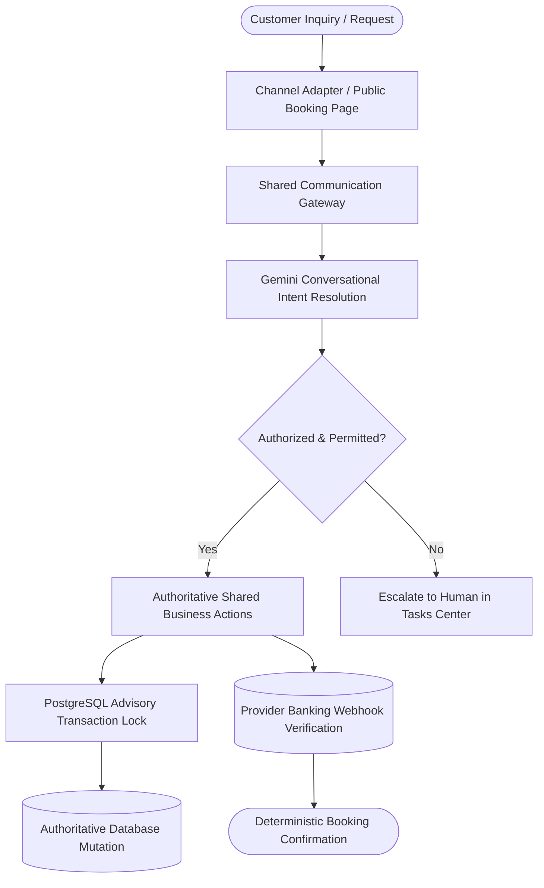
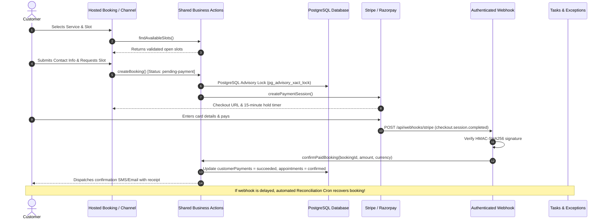

# Operator — Founder Operating & Demonstration Manual
**From Absolute Beginner to Master Operator**

---

## 1. Executive Overview: What Is Operator?

**Operator** is an autonomous AI receptionist and operations platform engineered specifically for appointment-based service businesses (salons, wellness spas, dental offices, medical practices, law firms, and consulting agencies).

### Who Uses It?
- **Small and Medium Business Owners:** Who lose thousands of dollars every month from unanswered calls, missed after-hours inquiries, and appointment no-shows.
- **Front-Desk Staff & Office Managers:** Who spend 40% of their workday playing phone tag, manually collecting deposits, and re-entering booking details.
- **Customers & Patients:** Who expect instant 24/7 self-service booking, fast policy answers, and zero hold times on the phone.

### What an Autonomous Receptionist Does:
1. **Engages 24/7:** Answers inquiries across Phone (Voice AI), WhatsApp, SMS, and Hosted Web Booking Pages without human fatigue.
2. **Grounded Policy Retrieval:** Answers questions using only the business's approved documents and FAQs with verifiable citations—never guessing or fabricating answers.
3. **Deterministic Booking:** Discovers open calendar slots, checks staff availability in real time, and locks appointments using database transaction concurrency guards.
4. **Authoritative Payment Collection:** Enforces deposit policies, creates secure checkout links, verifies provider webhooks (Stripe / Razorpay), and confirms bookings only when payment is authoritatively verified.
5. **Operational Exception Triage:** Catches undelivered messages, channel drops, and edge-case customer requests, surfacing them in the **Tasks & Exceptions Center** with safe one-click recovery actions.

---

## 2. Core Architectural Principle: AI Reasoning vs. Deterministic Actions

The most critical mental model for the founder to understand and communicate to prospective clients is:

> **The AI provides conversational intelligence; the database and banking APIs provide authoritative truth.**

- **What the AI CAN do:** Interpret natural language, detect customer sentiment, extract requested services and times, formulate empathetic grounded answers, and select from permitted business actions.
- **What the AI CANNOT do:** Confirm a booking without a verified calendar lock, invent or modify service prices, declare a payment succeeded without a cryptographic webhook signature, or bypass tenant isolation permissions.

---

## 3. Step-by-Step Business Setup (From Scratch)

Setting up a business on Operator requires zero programming.

### Step 1: Business Profile & Timezone
- Navigate to **Business Settings > Business Profile**.
- Enter Business Name, Address, Contact Phone, and Primary Timezone.
- *Crucial note on Timezones:* Operator stores all timestamps internally as UTC instants while computing availability and displaying calendar slots in the business-local timezone.

### Step 2: Define Operating Hours
- Navigate to **Business Settings > Operating Hours**.
- Set the weekly schedule (e.g., Monday–Friday 9:00 AM to 6:00 PM, Saturday 10:00 AM to 4:00 PM, Sunday Closed).
- Operator strictly rejects appointment requests outside these windows and proactively suggests the nearest available open times.

### Step 3: Configure Services & Pricing
- Navigate to **Services & Pricing**.
- Click **Add Service** and provide:
  - **Service Name** (e.g., "Full Balayage & Blowdry")
  - **Category** (e.g., "Hair Treatments")
  - **Duration** (e.g., 90 minutes) — *Essential for calendar slot calculation.*
  - **Price** (e.g., $180.00)
  - **Deposit Required** (e.g., $45.00 deposit or full prepayment)

### Step 4: Add Staff Members & Schedules
- Navigate to **Staff & Schedules**.
- Add staff profiles with their assigned services.
- Define individual weekly shift schedules to account for staggered days off, part-time shifts, and lunch breaks.

### Step 5: Ingest Business Knowledge & FAQs
- Navigate to **Business Knowledge**.
- Upload cancellation policies, intake guidelines, aftercare instructions, or PDF brochures.
- Operator segments the text into semantic chunks, generates vector embeddings, and links all customer answers directly to these chunks.

---

## 4. The Complete Customer Booking & Payment Lifecycle

### Invariant Safeguards:
1. **Zero Browser Redirect Trust:** The customer reaching `/book/success` does not confirm a booking. Confirmation only occurs when the cryptographic webhook signature is verified or provider API is queried directly.
2. **Double-Booking Prevention:** Even if two customers click "Book" for 2:00 PM within 10 milliseconds, PostgreSQL advisory transaction locks guarantee exactly one transaction succeeds. The second receives an immediate HTTP 409 Conflict with alternative times.
3. **Integer Minor Units:** All payments and deposits are calculated and stored in integer cents (e.g., $25.00 is stored as `2500` minor units, USD), preventing floating-point rounding errors.

---

## 5. Channel Integrations & Honest Verification Levels

Operator supports 5 customer reception channels. Each channel has an explicit verification status:

| Channel | Responsibilities | Requirements | Status / Verification Level |
| :--- | :--- | :--- | :--- |
| **Hosted Booking Page** | Standalone public booking URL (`/book/[slug]`) | Zero external credentials needed; active out of the box | **Production Verified** |
| **Website Chat Widget** | Optional embeddable chat iframe for client website | Script snippet pasted into website HTML | **Production Verified** |
| **SMS Reception & Alerts** | Inbound/outbound 2-way texting & appointment reminders | Twilio Account SID, Auth Token, verified phone number | **Sandbox / Production Verified** (when keys set) |
| **WhatsApp Business** | Customer chat, booking flows, interactive menus | Meta Cloud API Token, Phone Number ID, Webhook Verify Token | **Sandbox Verified** |
| **Voice AI Phone Line** | Autonomous conversational telephony | Twilio SIP / Webhook trunking + Gemini Realtime audio | **Sandbox Verified** |

> [!IMPORTANT]
> **Honest Verification Rule:** Operator never marks a channel "Connected" simply because a dummy string was typed into a field. Statuses clearly display: *Not Configured*, *Connected but Not Tested*, *Sandbox Verified*, or *Production Verified*.

---

## 6. Daily Operations: Omnichannel Inbox & Tasks Center

### Omnichannel Inbox (`/inbox`)
- Centralizes conversations across SMS, WhatsApp, and Web.
- Displays conversation history, customer contact metadata, and active appointments in the side panel.
- Allows staff to pause the AI receptionist and take over in real time with one click.

### Tasks & Exceptions Center (`/escalations`)
Consolidates all items requiring human review into two clear tabs:
1. **Operational Exceptions Tab:**
   - **Delivery Failures:** Carrier rejected SMS or bounced email.
   - **Payment Discrepancies:** Abandoned checkouts or delayed webhook notifications.
   - **Integration Alerts:** Expired OAuth tokens or dropped webhooks.
   - Every exception includes a **Safe Next Action**, retry counter, and one-click resolution.
2. **Customer Handoff Escalations Tab:**
   - Complex inquiries flagged when customer needs human consultation (e.g., enterprise VIP quote, specialized medical inquiry).

---

## 7. Customer Demonstration Playbook: 4 Industry Verticals

Use the **Founder Demo Control Center** (`/demo-center`) to present live demonstrations to prospects:

### Vertical 1: Salon & Spa ("Luxe Wellness & Spa")
- **Prospect Persona:** Salon Owner or Lead Esthetician.
- **Pain Point:** Stylists miss calls while doing hair treatments; high no-show rate for $150+ color services.
- **Demonstration Script:**
  1. Open `/demo-center` and select **Salon & Spa**.
  2. Launch the public booking link (`/book/luxe-spa`).
  3. Book a 90-minute Balayage with Master Stylist Elena.
  4. Demonstrate the $45 deposit checkout requirement.
  5. Show how the appointment immediately syncs to Elena's schedule without phone tag.
- **Key Metric:** Model proves 24 recovered bookings/month and no-show reduction from 16% to 2%.

### Vertical 2: Dental Clinic ("Apex Dental Care")
- **Prospect Persona:** Practice Manager or Dentist.
- **Pain Point:** Front desk overwhelmed during morning rushes; emergency toothache calls lost to competitors.
- **Demonstration Script:**
  1. Select **Dental Clinic** template.
  2. Simulate patient emergency query: "I chipped my tooth and am in pain, can I be seen today?"
  3. Show Operator referencing the Knowledge Base emergency protocol, identifying an open buffer slot, and collecting dental insurance carrier info.
- **Key Metric:** Captures 38% after-hours emergency volume and saves 24 front-desk hours/month.

### Vertical 3: Medical Clinic ("Beacon Health Associates")
- **Prospect Persona:** Clinic Director or Office Administrator.
- **Pain Point:** Phones tied up with routine refill and clinic hour questions, delaying urgent patient care.
- **Demonstration Script:**
  1. Select **Medical Clinic** template.
  2. Ask: "What are your flu shot hours and how do I refill blood pressure medication?"
  3. Show Operator answering from approved clinic policy without hallucinating medical advice.
  4. Show clinical safety guardrail: emergency chest pain mentions trigger immediate 911 guidance and nurse alert.
- **Key Metric:** Deflects 60% of routine non-revenue phone calls.

### Vertical 4: Law Firm & Consultant ("Vanguard Legal Advisory")
- **Prospect Persona:** Managing Partner or Senior Attorney.
- **Pain Point:** Prospects call multiple firms; slow response means lost $5,000+ legal retainers.
- **Demonstration Script:**
  1. Select **Law Firm & Consultant** template.
  2. Show confidential practice area qualification questions (Family Law vs. Commercial Litigation).
  3. Demonstrate collection of $150 upfront consultation fee credited toward retainer.
  4. Show instant partner calendar booking with NDA and case summary attached.
- **Key Metric:** Converts 52% of after-hours executive inquiries with zero no-shows.

---

## 8. Pre-Launch Go-Live Readiness Verification

Before switching Operator to live client traffic, verify these items:

- [ ] **Business Profile:** Address, phone, and local timezone match actual location.
- [ ] **Operating Hours:** Accurately set for all 7 days of the week.
- [ ] **Services & Staff:** Every active service has at least one qualified staff member with defined shifts.
- [ ] **Deposit & Pricing Policy:** Service prices and required deposits confirmed with business owner.
- [ ] **Knowledge Base:** Uploaded documents contain current cancellation, refund, and service guidelines.
- [ ] **Test Booking Completed:** Founder successfully books a test slot on the public booking link.
- [ ] **Payment Sandbox Tested:** Successful and failed payment test runs verified in the Demo Simulator.
- [ ] **Tasks & Exceptions Center:** Clean slate confirmed (zero unresolved critical exceptions).

---

## 9. Comprehensive Technical Glossary

- **Webhooks:** Automated HTTP POST messages sent by external services (like Stripe or Twilio) to notify Operator instantly when an event happens (e.g., payment succeeded, SMS delivered).
- **HMAC Signature Verification:** A mathematical cryptographic check ensuring that an incoming webhook genuinely originated from Stripe or Twilio and was not forged by an attacker.
- **Idempotency:** A design property guaranteeing that if a network glitch causes the exact same request or webhook to arrive 5 times, Operator executes the business action exactly once and ignores the duplicates.
- **Advisory Transaction Lock (`pg_advisory_xact_lock`):** A PostgreSQL database locking mechanism that prevents race conditions, ensuring two customers clicking "Book" at the same instant can never double-book the same slot.
- **RAG (Retrieval-Augmented Generation):** The AI technique where Operator searches your uploaded business documents for relevant facts first, and feeds those verified facts to Google Gemini to formulate the final grounded answer.
- **Grounding & Citations:** Guaranteeing that every claim made by the AI receptionist includes a direct reference to an approved document chunk, eliminating hallucinations.
- **Tenant Isolation:** Architectural separation ensuring that Company A's data, appointments, customers, and staff can never be seen, edited, or queried by Company B.
- **Reconciliation Cron:** A scheduled automated background worker that scans for transactions left in limbo (e.g., customer paid on Stripe but closed their laptop before redirecting) and safely synchronizes the database.
- **Integer Minor Units:** Storing money in cents rather than decimal dollars (e.g., $10.50 is stored as `1050`), preventing rounding errors inherent in floating-point math.
